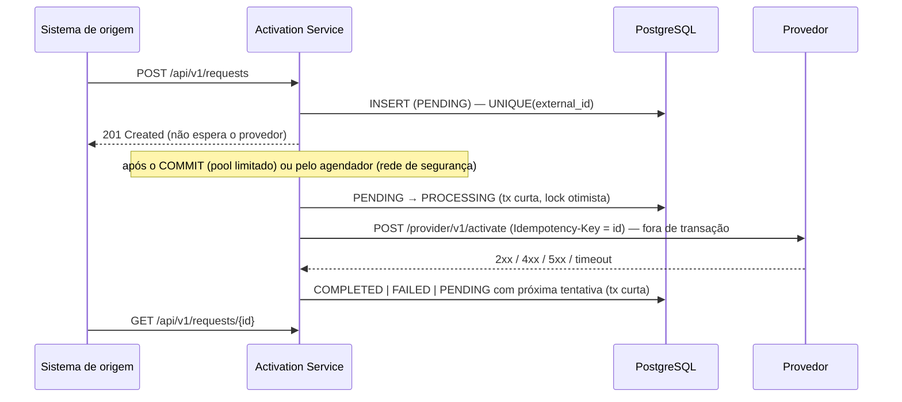

# Activation Service

Serviço de ativação de produtos de clientes: registra solicitações, consulta status e ativa o produto
em um provedor externo.

**Stack:** Java 21 · Spring Boot 3.5 (Spring MVC, Spring Data JPA/Hibernate, Spring Security) ·
PostgreSQL 16 + Flyway · Maven · JUnit 5, Mockito, AssertJ, Testcontainers, WireMock, Awaitility, ArchUnit ·
Micrometer/Prometheus/OpenTelemetry · Docker · GitHub Actions.

> Princípio adotado: o enunciado repete que não quer arquitetura excessivamente complexa. A solução é um
> único serviço em camadas simples (`web → application → infrastructure → domain`), sem fila externa,
> sem portas/adaptadores para tudo e sem bibliotecas de resiliência. A complexidade ficou só onde o
> problema exige: unicidade sob concorrência e entrega confiável ao provedor.

---

## Sumário

1. [Como executar](#como-executar)
2. [API](#api)
3. [Decisões técnicas](#decisões-técnicas)
4. [Estratégia de testes](#estratégia-de-testes)
5. [Cenário de análise (item 10)](#cenário-de-análise-item-10)
6. [Produção](#produção)
7. [Microsserviços e cloud](#microsserviços-e-cloud)
8. [Pontos pendentes](#pontos-pendentes)
9. [Melhorias futuras](#melhorias-futuras)
10. [Uso de IA](#uso-de-ia)

---

## Como executar

Pré-requisitos: **JDK 21** e **Docker** (o Maven vem pelo wrapper `mvnw`).

### Tudo com um comando (aplicação + PostgreSQL + mock do provedor)

```bash
docker compose up --build
```

| Serviço | Endereço |
|---|---|
| API | http://localhost:8080 |
| Health / métricas (porta de gestão) | http://localhost:8081/actuator/health/readiness · `/actuator/prometheus` |
| Mock do provedor (WireMock) | http://localhost:8089 |

Gere um token de desenvolvimento e chame a API:

```bash
TOKEN=$(./scripts/dev-token.sh)            # Windows (PowerShell): $TOKEN = .\scripts\dev-token.ps1

curl -i http://localhost:8080/api/v1/requests \
  -H "Authorization: Bearer $TOKEN" -H "Content-Type: application/json" \
  -d '{"externalId":"EXT-12345","customerId":"CUST-10001","productCode":"INTERNET-500"}'

curl -s http://localhost:8080/api/v1/requests/<id> -H "Authorization: Bearer $TOKEN"
```

O mock do provedor reage ao `productCode`, para exercitar cada cenário:

| `productCode` começa com | Resposta do provedor | Resultado esperado |
|---|---|---|
| qualquer outro | `200` | `COMPLETED` |
| `INVALID` | `400` | `FAILED` (sem nova tentativa) |
| `ERROR` | `500` | novas tentativas → `FAILED` após 5 |
| `SLOW` | demora 5 s (timeout de 3 s) | novas tentativas → `FAILED` após 5 |
| `THROTTLE` | `503` + `Retry-After: 10` | novas tentativas respeitando o prazo |
| `FLAKY` | `502` e depois `200` | `COMPLETED` com 2 tentativas |

Exemplos prontos em [`docs/requests.http`](docs/requests.http) (VS Code REST Client / IntelliJ).

### Testes

```bash
./mvnw test      # unitários + slices (sem Docker)
./mvnw verify    # + integração com Testcontainers (PostgreSQL real) — precisa de Docker
```

No Windows use `mvnw.cmd test` / `mvnw.cmd verify`.

### Rodar a aplicação fora do Docker

```bash
docker compose up -d postgres provider-mock
./mvnw spring-boot:run -Dspring-boot.run.profiles=local
```

---

## API

| Método | Caminho | Escopo | Respostas |
|---|---|---|---|
| `POST` | `/api/v1/requests` | `activation:write` | `201` + `Location` · `200` (repetição idempotente) · `400` · `401` · `403` · `409` · `413` · `429` |
| `GET` | `/api/v1/requests/{id}` | `activation:read` | `200` · `400` (id não é UUID) · `404` |
| `GET` | `/api/v1/requests?status=&customerId=&page=&size=` | `activation:read` | `200` (paginado, `size` ≤ 100, ordenado por `createdAt` desc) · `400` |

```json
// POST /api/v1/requests
{ "externalId": "EXT-12345", "customerId": "CUST-10001", "productCode": "INTERNET-500" }

// 201 Created — Location: /api/v1/requests/0b7f3c1e-5d2a-4c4e-9a51-2f8d7b1e6c90
{
  "id": "0b7f3c1e-5d2a-4c4e-9a51-2f8d7b1e6c90",
  "externalId": "EXT-12345",
  "customerId": "CUST-10001",
  "productCode": "INTERNET-500",
  "status": "PENDING",
  "attempts": 0,
  "createdAt": "2026-10-26T14:03:11.123Z",
  "updatedAt": "2026-10-26T14:03:11.123Z"
}
```

**Validação** (`externalId`, `customerId`, `productCode`): obrigatórios, até 64 caracteres, começam com
letra ou dígito e aceitam apenas letras, dígitos e `. _ : -` (sem espaços). Corpo limitado a 16 KB.

**Datas:** sempre UTC em ISO-8601, truncadas em milissegundos (o PostgreSQL guarda microssegundos e a
JVM gera nanossegundos; sem truncar, o `createdAt` do `POST` seria diferente do lido no `GET`).

**Campos adicionais:** `attempts` (tentativas de envio ao provedor) e `failureReason` (presente quando há
erro, ex.: `PROVIDER_REJECTED: HTTP 400 - ...`, `MAX_ATTEMPTS_EXCEEDED: TIMEOUT`).

**Erros** em Problem Details (RFC 9457), com `traceId` para localizar o log; o mesmo valor volta no
header `X-Trace-Id` de toda resposta:

```json
HTTP/1.1 400 Bad Request
Content-Type: application/problem+json

{
  "type": "https://api.exemplo.com/problems/validation-error",
  "title": "Dados inválidos",
  "status": 400,
  "detail": "Um ou mais campos não passaram na validação.",
  "instance": "/api/v1/requests",
  "traceId": "4bf92f3577b34da6a3ce929d0e0e4736",
  "errors": [ { "field": "customerId", "message": "é obrigatório" } ]
}
```

---

## Decisões técnicas

Registros completos em [`docs/adr`](docs/adr). Resumo:



### Duplicidade (item 3)
- **`UNIQUE (external_id)` no banco é a garantia.** "Consultar e depois inserir" tem uma janela de
  corrida entre o `SELECT` e o `INSERT`; não há linha para travar com `FOR UPDATE`, e lock em memória não
  funciona com várias instâncias.
- A consulta prévia é só atalho para o retry comum. Na corrida, a violação da constraint é capturada e a
  solicitação vencedora é relida **em nova transação** (o PostgreSQL aborta a transação que falhou).

| Cenário | Resposta | Justificativa |
|---|---|---|
| Mesmo `externalId`, mesmo conteúdo (retry legítimo) | `200 OK` com o registro existente, `Location` e `Idempotent-Replayed: true` | O cliente que fez retry (ex.: perdeu a resposta por timeout) recebe o mesmo resultado sem tratar erro. `201` seria incorreto (nada foi criado) e `409` forçaria o cliente a tratar como falha algo que deu certo. |
| Mesmo `externalId`, conteúdo diferente | `409 Conflict` — "O externalId 'X' já foi utilizado com dados diferentes" | É um erro do cliente que reutilizou o identificador; não pode sobrescrever nem ser ignorado silenciosamente. |
| Duas requisições idênticas em paralelo | uma recebe `201`; a outra `200` com o mesmo registro | A segunda falha no `INSERT`, relê e cai no caso de retry legítimo. |
| Mesmo `externalId` vindo de **outro** consumidor | `409`, sem dados do registro existente | Não vaza informação entre consumidores. |

### Estados e transições (item 4)
`PENDING → PROCESSING → COMPLETED | FAILED`, e `PROCESSING → PENDING` em falha temporária.
- Transições só por métodos de domínio (`startProcessing`, `complete`, `fail`, `retryLater`), sem setters;
  `COMPLETED` e `FAILED` são terminais (`InvalidStatusTransitionException`).
- **Falha temporária volta para `PENDING`** com `attempts` incrementado e `nextAttemptAt` agendado. Assim
  `PROCESSING` significa sempre "há uma chamada em andamento agora" — o que permite detectar solicitações
  presas (instância caiu no meio da chamada) por um lease de 60 s.
- **Escrita concorrente:** `@Version` (lock otimista). Duas instâncias disputando a mesma solicitação: só a
  primeira grava; a outra desiste sem chamar o provedor.

### Integração com o provedor (item 5)

| Retorno do provedor | Novo status | Nova tentativa? | Justificativa |
|---|---|---|---|
| Sucesso (2xx) | `COMPLETED` | não | Produto ativado. |
| HTTP 400 (e demais 4xx não listados) | `FAILED` | não | Requisição inválida para o provedor; repetir não muda o resultado. Motivo registrado em `failureReason`. |
| HTTP 500 (5xx) | `PENDING` → `FAILED` ao esgotar | sim, até 5, com backoff exponencial + jitter | Erro do lado do provedor, normalmente transitório. |
| Timeout | `PENDING` → `FAILED` ao esgotar | sim, **com a mesma `Idempotency-Key`** | Ambíguo: o provedor pode ter ativado. A chave permite que ele deduplique. |
| HTTP 429 / 503 com `Retry-After` | `PENDING` | sim, **não antes** do prazo pedido (limitado a 15 min) | Respeitar o pedido do provedor evita agravar a sobrecarga. Aceita segundos ou data HTTP. |
| HTTP 408 / 425 | `PENDING` | sim | Semanticamente temporários. |
| HTTP 401 / 403 | `PENDING` (com log de erro) | sim | Problema da **nossa** credencial (expirou/rotacionou), não da solicitação. Falhar definitivamente perderia todas as ativações até alguém corrigir. |
| Falha de conexão | `PENDING` | sim | A requisição não chegou ao provedor; reenviar é seguro. |

- **Síncrono ou assíncrono:** assíncrono. O `POST` responde em milissegundos independentemente do
  provedor; se ele ficar lento (400 ms → 3 s no cenário do item 10), a API não sente e threads/conexões não
  ficam presas.
- **Transação × chamada remota:** nenhuma chamada HTTP dentro de transação. Três passos curtos: reivindica
  (PENDING → PROCESSING, commit), chama o provedor, registra o resultado (commit). Uso `TransactionTemplate`
  explícito, o que também evita a armadilha do `@Transactional` ignorado em auto-invocação.
- **Garantia de envio mesmo se a aplicação cair entre o commit e a chamada:** a tabela é a própria outbox.
  Disparo imediato após o commit (pool limitado) + agendador que varre `PENDING` vencidas. Se o pool estiver
  cheio, a tarefa é descartada sem prejuízo; se a instância cair durante a chamada, o reconciliador devolve
  a solicitação para a fila após o lease.
- **Timeouts explícitos:** connect 1 s e read 3 s (`PROVIDER_CONNECT_TIMEOUT`, `PROVIDER_READ_TIMEOUT`), via
  `RestClient` + `JdkClientHttpRequestFactory`.
- **Limite de tentativas:** 5 (2 s, 4 s, 8 s, 16 s… com jitter, teto de 5 min). Ao atingir, `FAILED` com
  `MAX_ATTEMPTS_EXCEEDED: <motivo>`.
- **Circuit breaker:** analisado e adiado de propósito ([ADR 0004](docs/adr/0004-resiliencia-sem-circuit-breaker-por-enquanto.md)).

### Erros (item 6)
`@RestControllerAdvice` estendendo `ResponseEntityExceptionHandler` com `ProblemDetail` do Spring 6:
dados inválidos (`400` com lista de campos), JSON malformado (`400` sem repassar a mensagem do Jackson, que
expõe classes internas), id inexistente (`404`), duplicidade (`409`), corpo grande (`413`), rate limit
(`429`) e erro inesperado (`500` genérico; detalhe só no log, achado pelo `traceId`).
Erros de integração com o provedor **não** viram 5xx na API, porque o envio é assíncrono: aparecem no
recurso (`status`, `attempts`, `failureReason`). `server.error.include-stacktrace=never` como segunda barreira.

### Segurança (item 7) — implementada
- **Spring Security como Resource Server JWT**, fluxo **client credentials** (sistema-a-sistema).
- Valida **assinatura** (JWKS do servidor de autorização em produção), **emissor**, **audiência**
  (`activation-api`) e **expiração**.
- **Escopos:** `activation:write` cria; `activation:read` consulta e lista.
- **Isolamento entre consumidores (OWASP API1 — BOLA):** a solicitação guarda o `client_id` do token;
  consultas filtram por ele e solicitação de outro consumidor responde `404`.
- **Credencial do provedor:** variável de ambiente injetada pelo cofre de segredos, rotação por rolling
  restart, nunca logada.
- Limite de corpo (inclusive em chunks, sem `Content-Length`) e rate limit por consumidor.
- Desenvolvimento usa HS256 com segredo local; **o perfil `prod` recusa subir com segredo HMAC**.

Detalhes: [ADR 0003](docs/adr/0003-seguranca-oauth2-client-credentials.md).

### Persistência e índices
- Schema versionado com Flyway; Hibernate em `ddl-auto: validate`.
- `spring.jpa.open-in-view: false` — o padrão do Spring Boot mantém a conexão do banco presa durante toda
  a requisição HTTP (ver item 10).
- Id gerado na aplicação (UUID) com `@Version` do tipo `Long`: o Spring Data usa `version == null` para saber
  que a entidade é nova e faz `persist` em vez de `merge` (sem `SELECT` extra por criação).
- Filtros da listagem com `Specification` (Criteria API), evitando `(:param is null or coluna = :param)`,
  que no PostgreSQL pode falhar ao inferir o tipo do parâmetro nulo e atrapalha o uso de índices.

| Índice | Atende |
|---|---|
| `UNIQUE (external_id)` | duplicidade e busca por `externalId` |
| `(client_id, created_at DESC)` | listagem sem filtro (sempre filtrada por consumidor e ordenada) |
| `(client_id, status, created_at DESC)` | listagem por status |
| `(client_id, customer_id, created_at DESC)` | listagem por cliente |
| `(next_attempt_at) WHERE status = 'PENDING'` | worker: solicitações vencidas (índice parcial, pequeno) |
| `(updated_at) WHERE status = 'PROCESSING'` | reconciliador: solicitações presas |

### Observabilidade
- Actuator com `liveness` e `readiness`; porta de gestão separada (8081) nos perfis `docker`/`prod`.
- Métricas Micrometer para Prometheus: `http.server.requests` (latência da API, com histograma),
  `http.client.requests` e `activation.provider.calls{outcome}` (latência e taxa de erro do provedor),
  `activation.requests{status}` (solicitações por status) e `activation.requests.creation{outcome}`
  (`created`/`replayed`/`conflict`).
- Tracing OpenTelemetry (Micrometer Tracing): `traceparent` propagado ao provedor; o contexto passa da
  thread HTTP para a thread de envio (`ContextPropagatingTaskDecorator`), então o mesmo `traceId` aparece no
  log da API e no da chamada ao provedor. Exportação OTLP ligada por `MANAGEMENT_OTLP_TRACING_ENDPOINT`.
- Logs estruturados em JSON (ECS, com `traceId`/`spanId`) nos perfis `docker`/`prod`. Tokens e
  credenciais não são logados.

### Java moderno (onde fez sentido)
`record` para DTOs, comandos e propriedades; `sealed interface` + `switch` com pattern matching para o
resultado do provedor (`ProviderResult`) e da criação (`CreationResult`) — adicionar um caso novo quebra a
compilação até ser tratado.

---

## Estratégia de testes

O foco é confiança para alterar o sistema, não percentual de cobertura.

| Nível | Classe | O que garante |
|---|---|---|
| Unitário (sem Spring) | `ActivationRequestTest` | Regras de domínio e a matriz completa de transições (válidas e inválidas). |
| Unitário | `RetryPolicyTest` | Backoff exponencial, jitter, teto, `Retry-After`, limite de tentativas. |
| Unitário (Mockito) | `ActivationDispatcherTest` | Decisão para cada retorno do provedor; disputa entre workers; resultado obsoleto; erro inesperado não derruba o worker; reconciliação. |
| Unitário | `RateLimitFilterTest`, `RequestBodyLimitFilterTest` | Token bucket por consumidor; corpo grande com e sem `Content-Length`. |
| Integração HTTP (WireMock) | `HttpActivationProviderTest` | Cliente real contra provedor simulado: corpo, `Idempotency-Key`, credencial, 400, 500, 503/429 com `Retry-After` (segundos e data), 401, **timeout** e conexão recusada. |
| Slice web (`@WebMvcTest`) | `ActivationRequestControllerTest` | Contrato HTTP, validação, Problem Details, ausência de detalhes internos, 413 e segurança com **JWT assinado de verdade** (401 sem token, assinatura inválida, emissor, audiência, expiração; 403 por escopo). |
| Integração (Testcontainers) | `ActivationRequestRepositoryIT` | Mapeamento JPA × schema Flyway, constraint única, lock otimista, consultas do worker. |
| Ponta a ponta (Testcontainers + WireMock) | `ActivationFlowIT` | Criação → envio → `COMPLETED`; 400 → `FAILED`; 500 → retry → sucesso; timeout → retry com a mesma chave; esgotamento de tentativas; reconciliação de solicitação presa; BOLA; listagem; health e métricas. |
| Concorrência (Testcontainers) | `ConcurrentDuplicateIT` | 20 requisições simultâneas com o mesmo `externalId` → exatamente um registro (um `201`, demais `200`); com conteúdos diferentes → um `201`, demais `409`. Repetido 3×. |
| Arquitetura (ArchUnit) | `ArchitectureTest` | Domínio sem dependência de Spring/camadas; web não acessa infraestrutura; sem ciclos entre pacotes. |

`./mvnw test` roda tudo que não precisa de Docker (Surefire); `./mvnw verify` inclui os `*IT` (Failsafe).
O CI (GitHub Actions) executa `verify` e o build da imagem a cada push/PR.

---

## Cenário de análise (item 10)

Sintomas: API 300 ms → 2,5 s; CPU 45%; memória 60%; algumas consultas 50 ms → 1,2 s; provedor 400 ms → 3 s.

**1. O que investigaria primeiro?**
CPU e memória folgadas indicam que a aplicação não está calculando mais — está **esperando** (I/O, lock ou
fila por recurso). Começaria pela linha do tempo: o que mudou quando a lentidão começou (deploy, volume,
provedor, migração de banco) e se ela atinge todos os endpoints ou só alguns. Olharia percentis
(p95/p99), não a média, e separaria `POST` de `GET`.

**2. Como identificar se é aplicação, banco ou integração?**
- **Tracing distribuído:** um trace de requisição lenta mostra onde o tempo foi gasto (span HTTP do provedor,
  span JDBC, ou espera antes do span JDBC começar — sinal de fila por conexão).
- **Pool de conexões (Hikari):** `hikaricp_connections_pending`, `hikaricp_connections_acquire_seconds`,
  `active` vs `max`. Muita espera para obter conexão é problema da aplicação segurando conexões, não do banco.
- **Banco:** `pg_stat_statements` (tempo de execução real das queries), `pg_stat_activity` (sessões
  `idle in transaction`, `wait_event` de lock), `EXPLAIN ANALYZE` das queries que pioraram.
- **Integração:** `http.client.requests` por status/latência, timeouts, retries.
- **Thread dump:** threads paradas em `HikariPool.getConnection` ou em leitura de socket do cliente HTTP.

**3. Logs e métricas úteis:** latência por endpoint (`http.server.requests`), latência e erros do provedor
(`http.client.requests`, `activation.provider.calls`), métricas do Hikari, threads ocupadas do Tomcat,
GC/heap (para descartar), slow query log do PostgreSQL, logs estruturados com `traceId` para cruzar tudo e
volume de requisições (para descartar aumento de carga).

**4. Melhorias:** timeouts curtos e explícitos; tirar a chamada ao provedor do caminho da requisição
(assíncrono); nunca manter transação/conexão aberta durante chamada remota (incluindo desligar
`open-in-view`); bulkhead (pool separado para o provedor); circuit breaker se o provedor continuar
instável; nas queries, índices adequados, paginação e evitar N+1; dimensionar o pool de conexões pelo banco,
não pelo número de threads.

**5. Os três sintomas podem ter causa comum? Hipótese:**
Sim. O provedor ficou lento (400 ms → 3 s) e a chamada a ele acontece **com uma conexão de banco presa** —
dentro de um `@Transactional` ou pelo Open Session in View (padrão `true` no Spring Boot), que segura a
conexão durante toda a requisição. Cada requisição passa a ocupar uma conexão por ~3 s em vez de ~0,4 s, o
pool (ex.: 10 conexões) esgota e as demais requisições ficam **na fila esperando conexão**. Do ponto de vista
da aplicação, "as consultas ficaram lentas" (o tempo medido inclui a espera pela conexão e eventuais locks de
transações longas), a API fica lenta e a CPU continua baixa, porque todo mundo está esperando.

**Como confirmar:** `hikaricp_connections_pending > 0` e `active = max` no mesmo intervalo da lentidão;
`acquire_seconds` alto; no PostgreSQL, a mesma query rápida no `pg_stat_statements` mas sessões
`idle in transaction`; no trace, o span JDBC começa tarde; e reprodução em homologação com o mock do
provedor atrasado 3 s (`fixedDelayMilliseconds` no WireMock) — a lentidão aparece em endpoints que nem
chamam o provedor.

Este serviço foi desenhado para não cair nisso: envio assíncrono, chamada HTTP fora de transação,
`open-in-view: false`, timeouts explícitos, pool limitado para o provedor e `connection-timeout` de 3 s no
Hikari (falha rápida em vez de fila longa).

**6. Como validar que a correção funcionou:** definir antes os indicadores de sucesso (p95/p99 da API,
taxa de erro, `hikaricp_connections_pending ≈ 0`, latência das queries); publicar em canário (uma parte do
tráfego) comparando com a versão anterior; acompanhar dashboards/alertas por pelo menos um ciclo de pico de
negócio; e manter um teste de carga com provedor lento no pipeline/homologação para evitar regressão.

---

## Produção

- **Imagem:** `Dockerfile` multi-stage (build com Maven, runtime JRE Alpine), camadas do Spring Boot
  (rebuild troca só a camada da aplicação), usuário não-root, `MaxRAMPercentage=75` (memória proporcional ao
  limite do contêiner), `ExitOnOutOfMemoryError`, `HEALTHCHECK` e `ENTRYPOINT` em forma exec (a JVM recebe o
  `SIGTERM`).
- **Execução:** Kubernetes (EKS/AKS) ou ECS, com **2+ réplicas**, `readinessProbe`/`livenessProbe` em
  `/actuator/health/readiness|liveness` na porta de gestão (8081, não exposta publicamente), requests/limits
  de CPU e memória, HPA por CPU/latência e PodDisruptionBudget.
- **Configuração:** variáveis de ambiente (`DB_URL`, `PROVIDER_BASE_URL`, `JWT_ISSUER`, `JWT_JWK_SET_URI`,
  timeouts...) e perfil `prod`; segredos (`DB_PASSWORD`, `PROVIDER_API_KEY`) do cofre de segredos.
- **Banco:** PostgreSQL gerenciado (RDS/Azure Database) com backup, réplica e alta disponibilidade.
  Migrações Flyway na subida (com lock do próprio Flyway, seguro com várias réplicas) ou como job separado
  antes do deploy, sempre compatíveis com a versão anterior (expand/contract).
- **Desligamento gracioso:** `server.shutdown=graceful`, espera das tarefas agendadas e do pool de envio;
  `preStop` curto no Kubernetes para o balanceador parar de enviar tráfego antes do `SIGTERM`.
- **Observabilidade:** Prometheus coleta `/actuator/prometheus`; logs JSON para o agregador
  (CloudWatch/ELK/Loki); traces via OTLP para um collector (Tempo/Jaeger/X-Ray); alertas em p99, taxa de erro,
  `activation_requests{status="PENDING"}` crescendo e `FAILED` por `MAX_ATTEMPTS_EXCEEDED`.
- **Atrás do load balancer:** `server.forward-headers-strategy=native` (perfil `prod`) para o `Location`
  sair com o host público.

---

## Microsserviços e cloud

- **Várias instâncias:** a unicidade é do banco (`UNIQUE`), não da memória. O processamento disputa cada
  solicitação com lock otimista; o reconciliador é idempotente. Todas as réplicas podem rodar o agendador;
  com muitas réplicas eu trocaria a busca por `SELECT ... FOR UPDATE SKIP LOCKED` (cada réplica pega um lote
  diferente) ou usaria ShedLock no reconciliador. O rate limit em memória é por réplica — o limite global fica
  no API Gateway.
- **Configurações e segredos:** configuração por variáveis de ambiente/ConfigMap; segredos no AWS Secrets
  Manager / Azure Key Vault, injetados no pod (Secrets Store CSI) — nunca no repositório ou na imagem.
- **Avisar outros serviços da ativação concluída:** publicar `ActivationCompleted`/`ActivationFailed` em um
  tópico (Kafka, SNS/SQS, Service Bus) usando **transactional outbox**: gravar o evento numa tabela
  `outbox` na mesma transação da mudança de status e um relay (ou Debezium/CDC) publica. Consumidores
  tratam duplicatas (entrega at-least-once) pelo id do evento.
- **CI/CD:** o workflow atual faz build, testes (incluindo Testcontainers) e build da imagem. Num pipeline
  completo: scan de dependências e da imagem (Trivy/Dependabot), push para o registry com a tag do commit,
  deploy automático em homologação, testes de fumaça, aprovação e deploy em produção (rolling ou canário).

---

## Pontos pendentes

O que deliberadamente não foi implementado e como eu faria:

- **Circuit breaker** — adiado com justificativa no [ADR 0004](docs/adr/0004-resiliencia-sem-circuit-breaker-por-enquanto.md);
  seria um decorator Resilience4j no cliente do provedor, reagendando sem consumir tentativa.
- **Servidor de autorização no `docker-compose`** — usei tokens HS256 de desenvolvimento para manter o
  ambiente leve. Em produção: Keycloak/Entra ID/Cognito com JWKS (`JWT_JWK_SET_URI`), já suportado pelo código.
- **Rate limit distribuído** — hoje é por instância; em produção ficaria no API Gateway (ou Redis).
- **Eventos para outros serviços** — descrito acima (outbox + tópico).
- **Documentação OpenAPI/Swagger** — substituída por esta seção e por `docs/requests.http`; seria
  `springdoc-openapi` com os exemplos e Problem Details documentados.
- **Manifestos Kubernetes/Terraform** — fora do escopo pedido; descritos na seção Produção.

## Melhorias futuras

- `SELECT ... FOR UPDATE SKIP LOCKED` e paralelismo configurável no worker para alta vazão.
- Arquivamento/particionamento por data quando a tabela crescer (os índices parciais do worker já não
  crescem com o histórico).
- Endpoint administrativo para reprocessar solicitações `FAILED` (com auditoria).
- Contrato do provedor formalizado (OpenAPI do provedor + teste de contrato).
- Testes de carga (Gatling/k6) com o provedor lento no pipeline, cobrindo o cenário do item 10.
- Migração para Spring Boot 4 / Spring Framework 7 quando a stack da empresa adotar.

---

## Uso de IA

Usei assistente de IA (Claude, da Anthropic) como par de programação: revisão do enunciado em busca de
pontos de atenção, discussão de alternativas de desenho, geração de rascunhos de código, testes e
documentação. Todas as decisões, o código e os testes foram revisados e validados por mim, e sei explicar
cada escolha registrada aqui e nos ADRs.
